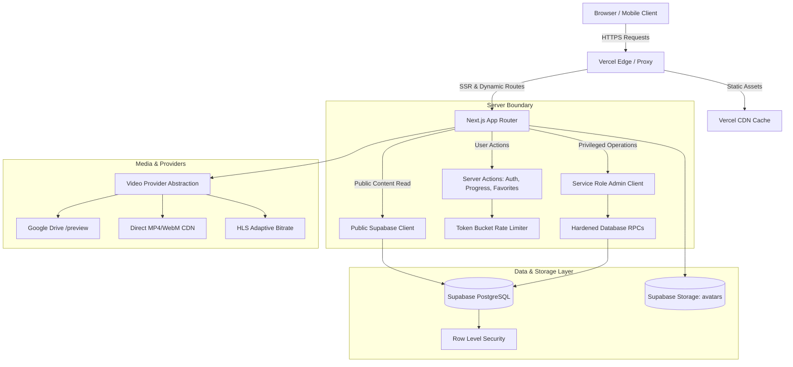

# AniCity — System Architecture & Technical Design

## 1. Executive Overview

AniCity (`yozora-app`) is a high-performance, responsive anime streaming web platform built on **Next.js 16 (App Router)** and **React 19**, deployed on **Vercel** with a **Supabase PostgreSQL** backend.

The platform is engineered to deliver:
- Seamless sub-second video playback across mobile and desktop viewports.
- Resilient defense-in-depth security with strict Row Level Security (RLS) and token bucket rate limiting.
- Zero client-side privilege escalation via atomic Database RPCs.
- High discovery velocity via fuzzy search and structured JSON-LD semantic metadata.

---

## 2. Technology Stack & Runtime Topology

| Layer | Technology | Key Responsibility |
| :--- | :--- | :--- |
| **Edge & CDN** | Vercel Global Edge Network | Dynamic SSR, static asset caching, DDoS mitigation, HTTPS termination |
| **Framework** | Next.js 16.4.3 (Turbopack) | App Router, React Server Components (RSC), Server Actions |
| **UI Library** | React 19.0.0 | Concurrent rendering, Server Actions form binding, client state hooks |
| **Styling** | Custom Responsive CSS + Stitch UI | Dark cyberpunk aesthetic, mobile thumb-zone layout, zero-CLS skeletons |
| **Database** | Supabase Managed PostgreSQL 15 | Relational data, RLS policies, automated triggers, JSONB payloads |
| **Identity & Auth** | Supabase Auth + Google OAuth 2.0 | Session cookies (`sb-*`), PKCE flow, role claims in JWT and profiles table |
| **Storage** | Supabase Storage (`avatars` bucket) | User avatars, path traversal protection, image MIME verification |
| **Media Streaming** | Hybrid HLS / Direct MP4 / Google Drive | Multi-provider abstraction (`lib/video/provider.js`) with HMAC tokens |
| **Payments** | Click / Payme / Stripe / Sandbox | Idempotent webhook processing (`lib/payments/provider.js`) |

---

## 3. High-Level Data & Request Flow



---

## 4. Directory & Module Structure

```
yozora-app/
├── app/                        # Next.js App Router
│   ├── (auth)/                 # Login, Register, Forgot Password, Reset Password
│   ├── actions/                # Next.js Server Actions (auth, progress, favorites, profile)
│   ├── admin/                  # Administrator Management Dashboard
│   ├── anime/[id]/             # Anime detail page with JSON-LD schema
│   ├── api/                    # REST API & Webhook endpoints
│   │   ├── animes/             # Public anime catalog & search
│   │   └── payments/webhook/   # Idempotent payment webhook receiver
│   ├── catalog/                # Discovery catalog & genre filtering
│   ├── watch/[animeId]/[num]/  # Video player & episode stream view
│   ├── globals.css             # Main styling system
│   ├── layout.js               # Root layout & context providers
│   ├── robots.js               # Dynamic SEO robots directives
│   └── sitemap.js              # Dynamic XML sitemap generator
├── components/                 # Reusable UI components
│   ├── Navbar.js               # Header, live search, notification center, thumb bar
│   ├── Player.js               # Comprehensive video player facade
│   ├── player/                 # Decomposed player subcomponents & hooks
│   └── AnimeRow.js             # Horizontal scrollable anime showcases
├── lib/                        # Core engineering libraries
│   ├── drive.js                # Google Drive stream normalization & security
│   ├── rate-limit.js           # Sliding-window in-memory rate limiter
│   ├── siteUrl.js              # Dynamic domain resolution
│   ├── storage.js              # Avatar URL sanitizer & path protection
│   ├── subscriptions.js        # VIP calculation & expiration logic
│   ├── validate.js             # Schema validation rules
│   ├── payments/provider.js    # Provider-agnostic payment architecture
│   ├── video/provider.js       # Streaming provider abstraction & HMAC tokens
│   └── supabase/               # Client, server, and admin client builders
├── supabase/migrations/        # 16+ production SQL migrations
├── tests/                      # 18 comprehensive automated regression suites
└── docs/                       # Complete operational and architectural guides
```

---

## 5. Security & Isolation Model

1. **Client Isolation:** Browsers never access or store the `SUPABASE_SERVICE_ROLE_KEY`. All privileged operations run inside server-only execution blocks (`'use server'`).
2. **Database Hardening:** All tables enforce Row Level Security (`ENABLE ROW LEVEL SECURITY`). Admin RPCs use `SECURITY DEFINER` with fixed `search_path = pg_catalog, public, pg_temp` to prevent schema injection.
3. **Session Cookies:** Managed via `@supabase/ssr` with `HttpOnly`, `Secure`, and `SameSite=Lax` cookies, preventing XSS-based token theft.
4. **Brute Force Defense:** Authentication actions (`login`, `register`, `forgotPassword`) enforce sliding-window rate limits keyed by real client IP addresses.
