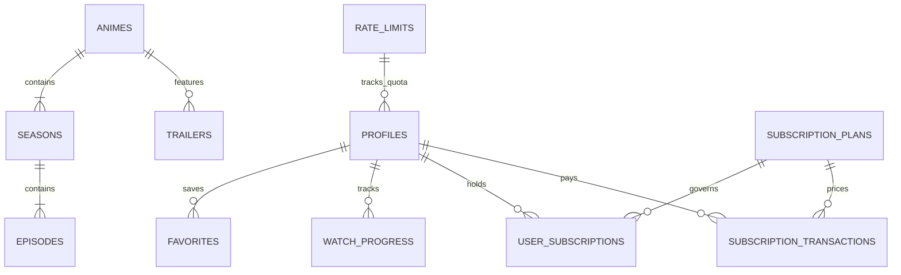

# AniCity — Database Architecture & SQL Schema Reference

## 1. Overview & Connection Topology

AniCity uses a managed **PostgreSQL 15** cluster hosted on **Supabase**. All database tables enforce PostgreSQL Row Level Security (RLS). Privileged transactions occur through `SECURITY DEFINER` stored procedures located in the `public` schema with fixed `search_path` controls (`SET search_path = pg_catalog, public, pg_temp`).

---

## 2. Migration Sequence

The database schema is constructed via an immutable, sequential migration pipeline under `supabase/migrations/`:

| Migration File | Description |
| :--- | :--- |
| `001_core_schema.sql` | Core schema: `profiles`, `animes`, `seasons`, `episodes`, `watch_progress`, `favorites`, `comments`, `ratings`. |
| `002_indexes.sql` | B-tree and GIN indexes for query optimization. |
| `003_functions_triggers.sql` | Auto-updating timestamp triggers and profile creation hooks. |
| `004_grants.sql` | Role permissions (`anon`, `authenticated`, `service_role`). |
| `005_rls_policies.sql` | Row Level Security policies for all core entities. |
| `006_storage.sql` | Storage bucket configurations and access policies for avatars/posters. |
| `007_trailers.sql` | Trailers and video clips schema. |
| `008_admin_decoupled_episodes.sql` | Decoupled anime creation support (animes without episodes initially). |
| `009_subscriptions_system.sql` | VIP subscription plans, transactions, user subscriptions, and audit logs. |
| `010_video_banners.sql` | Dynamic video banners and featured showcase carousel tables. |
| `011_schema_security_repairs.sql` | Hardening of RPC security definer signatures. |
| `011b_admin_anime_rpcs.sql` | Bridge RPCs: `admin_create_anime_with_episodes` and `admin_replace_anime_episodes`. |
| `012_admin_pagination_atomic_updates.sql` | Pagination RPC `admin_list_users` and atomic subscription grants. |
| `013_profiles_assistant_admins.sql` | Assistant admin role definitions, permissions table, and audit trail. |
| `014_assistant_permission_boundaries.sql` | Strict isolation of assistant permissions from owner capabilities. |
| `015_assistant_security_audit_fixes.sql` | Hardened `search_path = pg_catalog, public, pg_temp` across all administrative RPCs. |
| `016_episode_replacement_identity.sql` | Season-qualified episode replacement logic preserving published identity. |
| `017_distributed_rate_limiting.sql` | Distributed serverless rate-limiting table and atomic `check_rate_limit` RPC. |

---

## 3. Core Entity-Relationship Diagram



---

## 4. Key Table Schemas

### `public.animes`
- `id` (UUID, Primary Key)
- `title` (TEXT, 1–200 chars)
- `alt_title` (TEXT)
- `description` (TEXT)
- `year` (INT, 1960–2100)
- `type` (TEXT: 'tv', 'movie', 'ova', 'ona', 'special')
- `status` (TEXT: 'Tugallangan', 'Davom etmoqda')
- `genres` (TEXT[])
- `poster_url` (TEXT)
- `banner_url` (TEXT)
- `is_published` (BOOLEAN, default true)
- `rating_avg` (NUMERIC(4,2), default 0)
- `view_count` (BIGINT, default 0)

### `public.episodes`
- `id` (UUID, Primary Key)
- `anime_id` (UUID, FK -> `animes.id` ON DELETE CASCADE)
- `season_id` (UUID, FK -> `seasons.id` ON DELETE SET NULL)
- `number` (INT, positive)
- `title` (TEXT)
- `video_url` (TEXT, HTTP/HTTPS URL)
- `thumbnail_url` (TEXT)
- `is_published` (BOOLEAN, default true)
- `UNIQUE (anime_id, number)`

### `public.user_subscriptions`
- `id` (UUID, Primary Key)
- `user_id` (UUID, FK -> `profiles.id` ON DELETE CASCADE)
- `plan_id` (UUID, FK -> `subscription_plans.id` ON DELETE SET NULL)
- `plan_name` (TEXT)
- `status` (TEXT: 'active', 'expired', 'cancelled', 'pending')
- `starts_at` (TIMESTAMPTZ)
- `expires_at` (TIMESTAMPTZ)
- `grant_type` (TEXT: 'manual_admin', 'online_payment', 'promo_code', 'system')

### `public.subscription_transactions`
- `id` (UUID, Primary Key)
- `transaction_id` (TEXT, Unique)
- `user_id` (UUID, FK -> `profiles.id` ON DELETE CASCADE)
- `plan_id` (UUID, FK -> `subscription_plans.id`)
- `amount_uzs` (BIGINT)
- `currency` (TEXT, default 'UZS')
- `provider` (TEXT: 'payme', 'click', 'uzum', 'manual', 'other')
- `status` (TEXT: 'pending', 'completed', 'failed', 'cancelled')
- `metadata` (JSONB)

### `public.rate_limits` (Added in 017)
- `id` (BIGSERIAL, Primary Key)
- `key` (TEXT, UNIQUE, Not Null) - e.g. `auth:login:1.2.3.4`
- `points` (INT, Default 0) - Accumulated request count in window
- `expires_at` (TIMESTAMPTZ, Not Null) - Sliding window expiration
- `created_at` (TIMESTAMPTZ, Default now())
- `updated_at` (TIMESTAMPTZ, Default now())

---

## 5. Security & Index Optimization

### Critical Indexes
- `idx_user_subs_user_id` ON `user_subscriptions(user_id)`
- `idx_user_subs_status` ON `user_subscriptions(status)`
- `idx_user_subs_expires_at` ON `user_subscriptions(expires_at)`
- `idx_sub_tx_user_id` ON `subscription_transactions(user_id)`
- `idx_sub_tx_status` ON `subscription_transactions(status)`
- `idx_sub_audit_user_id` ON `subscription_audit_logs(user_id)`
- `idx_rate_limits_expires_at` ON `rate_limits(expires_at)`

### Hardened RPC Configuration
All admin RPCs are created with:
```sql
ALTER FUNCTION public.admin_create_anime_with_episodes(jsonb, jsonb)
  SET search_path = pg_catalog, public, pg_temp;
```
This protects against search_path hijacking where malicious users might create colliding functions or tables in personal schemas.
