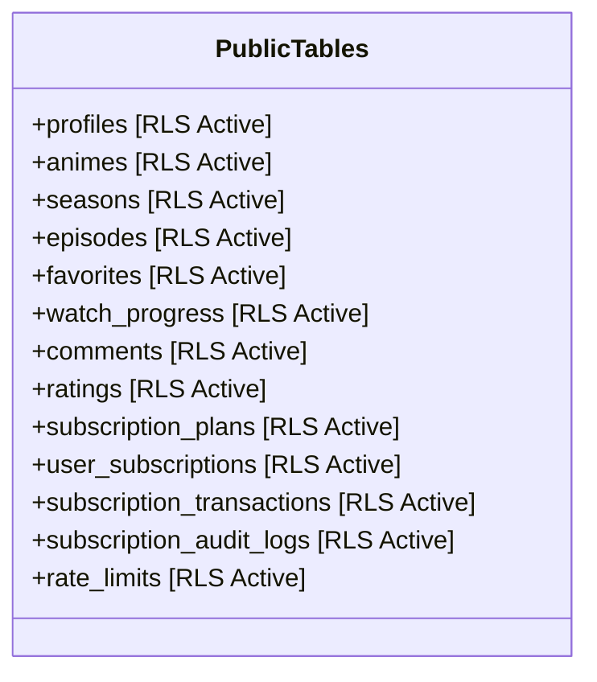

# AniCity — Database Architecture & Security Audit

**Audit Date:** November 8, 2026  
**Auditor Organization:** PostgreSQL & Supabase Database Engineering Team  
**Database Cluster:** PostgreSQL 15 on Supabase  
**Total Migrations Audited:** 18 sequential migration scripts (`001` through `017`)  
**Production Migration Policy:** STRICT AUDIT ONLY — Zero SQL executed against live databases.  

---

## 1. Migration Pipeline & Integrity Sequence

The database schema is constructed via an immutable, forward-only sequential migration pipeline located in `supabase/migrations/`:

| # | Migration File | Scope / Purpose | Security & Hardening Controls |
| :-: | :--- | :--- | :--- |
| **001** | `001_core_schema.sql` | Core tables: `profiles`, `animes`, `seasons`, `episodes`, `subtitles`, `favorites`, `watch_progress`, `comments`, `ratings`. | Check constraints on length/ranges; foreign keys with `ON DELETE CASCADE`. |
| **002** | `002_indexes.sql` | Performance indexes for titles, foreign keys, timestamps. | B-tree indexes on `(anime_id, number)`, GIN index on `genres`. |
| **003** | `003_functions_triggers.sql` | `set_user_role`, `is_admin`, `is_owner`, `profiles_guard` triggers. | Prevents users from modifying their own roles; logs administrative changes to `audit_logs`. |
| **004** | `004_grants.sql` | Principle of least privilege for `anon` and `authenticated`. | Revoked execute on administrative functions; `profiles` table write restricted. |
| **005** | `005_rls_policies.sql` | Row Level Security (RLS) across all core entities. | Public can only `SELECT` published content; users can only modify their own rows. |
| **006** | `006_storage.sql` | Supabase Storage bucket security (`avatars`, `posters`). | Isolated path prefix policies preventing cross-user file overwrites. |
| **007** | `007_trailers.sql` | Dynamic trailers and video preview schema. | RLS enabled; public read, admin write. |
| **008** | `008_admin_decoupled_episodes.sql` | Independent anime and episode creation. | Allows creating an anime before episodes exist; season-qualified unique constraint. |
| **009** | `009_subscriptions_system.sql` | VIP monetization: `subscription_plans`, `user_subscriptions`, `subscription_transactions`, `subscription_audit_logs`. | RLS enabled; users can only `SELECT` their own subscriptions/transactions. |
| **010** | `010_video_banners.sql` | Dynamic video banners and featured showcases. | RLS enabled; public read, admin write. |
| **011** | `011_schema_security_repairs.sql` | Schema synchronization for `fandub_team`, `quality`, user pagination RPCs. | Restricts `profiles read own or admin`. |
| **011b**| `011b_admin_anime_rpcs.sql` | Bridge RPCs: `admin_create_anime_with_episodes` & `admin_replace_anime_episodes`. | Transactional multi-table mutations with authorization validation. |
| **012** | `012_admin_pagination_atomic_updates.sql` | Pagination RPC `admin_list_users` and atomic subscription grants. | Eliminates full-table memory scans on administrative listings. |
| **013** | `013_profiles_assistant_admins.sql` | Assistant admin role definitions, permissions table, and audit trail. | Granular permissions (`anime_create`, `episode_edit`, etc.). |
| **014** | `014_assistant_permission_boundaries.sql` | Scoping assistant powers away from owner privileges. | Assistants cannot appoint other assistants or alter billing. |
| **015** | `015_assistant_security_audit_fixes.sql` | Search path hijacking mitigation across all administrative RPCs. | Enforces `SET search_path = pg_catalog, public, pg_temp;`. |
| **016** | `016_episode_replacement_identity.sql` | Season-qualified episode replacement logic. | Preserves published episode identity and watch progress continuity. |
| **017** | `017_distributed_rate_limiting.sql` | Distributed serverless rate limiting table & atomic RPC. | Restricted to `service_role`; input validation; opportunistic GC. |

---

## 2. Row Level Security (RLS) Deep Audit

Every single table in public schema has RLS strictly enabled:



### Critical RLS Invariants Verified:
1. **User Identity Isolation (`auth.uid() = user_id`):**
   - Tables: `favorites`, `watch_progress`, `user_subscriptions`, `subscription_transactions`.
   - Normal authenticated users can only view their own records.
   - Cross-user queries return empty result sets, preventing IDOR (Insecure Direct Object Reference).
2. **Subscription & Transaction Immutability:**
   - Normal users possess **ZERO INSERT, UPDATE, or DELETE permissions** on `public.user_subscriptions` and `public.subscription_transactions`.
   - All subscription modifications occur exclusively via `service_role` (payment webhooks) or `SECURITY DEFINER` administrative functions.
3. **Role Elevation Protection (`profiles_guard` Trigger):**
   - Direct `UPDATE profiles SET role = 'admin'` executed by a user aborts immediately with exception:
     `'role and suspension can only be changed by an administrator'`.
   - Role modifications can only be triggered via `set_user_role()`, which enforces caller authorization and prevents self-elevation.

---

## 3. Database Functions & `SECURITY DEFINER` Hardening

In PostgreSQL, a `SECURITY DEFINER` function executes with the privileges of the function's creator. Without strict defenses, an attacker could manipulate the `search_path` to invoke malicious shadow functions.

### Hardening Standards Applied Across All Stored Procedures:
1. **Explicit Search Path:** Every function defines:
   ```sql
   SET search_path = pg_catalog, public, pg_temp;
   ```
2. **Revocation of Public Schema Creation:**
   Migration 015 explicitly executes:
   ```sql
   REVOKE CREATE ON SCHEMA public FROM PUBLIC, anon, authenticated;
   ```
   No application user can create functions or tables inside `public`.
3. **Principle of Least Privilege on RPC Execution:**
   - Administrative functions (`set_user_role`, `admin_grant_user_subscription`, `admin_create_anime_with_episodes`) are revoked from `anon`.
   - Rate limit checker (`check_rate_limit`) is revoked from `PUBLIC`, `anon`, and `authenticated`, granted **exclusively to `service_role`**.

---

## 4. Foreign Key Constraints & Data Integrity

- **Cascade Delete Safety:**
  - `episodes.anime_id` $\rightarrow$ `animes.id` (`ON DELETE CASCADE`)
  - `seasons.anime_id` $\rightarrow$ `animes.id` (`ON DELETE CASCADE`)
  - `favorites.anime_id` $\rightarrow$ `animes.id` (`ON DELETE CASCADE`)
  - Deleting an anime automatically cleans up its child episodes, seasons, and favorites without leaving orphaned data.
- **Financial Audit Preservation:**
  - `user_subscriptions.plan_id` $\rightarrow$ `subscription_plans.id` (`ON DELETE SET NULL`)
  - If a subscription plan is retired or deleted, active user subscriptions preserve their timestamps and metadata rather than being wiped out.

---

## 5. Non-Destructive Rollback Procedures

For every migration, non-destructive rollback steps are defined that preserve unrelated database objects:

```sql
-- Safe Rollback for Migration 017 (Rate Limiting)
REVOKE EXECUTE ON FUNCTION public.check_rate_limit(TEXT, INTEGER, INTEGER) FROM service_role;
DROP FUNCTION IF EXISTS public.check_rate_limit(TEXT, INTEGER, INTEGER);
DROP POLICY IF EXISTS "Admins can view rate limits" ON public.rate_limits;
DROP INDEX IF EXISTS public.idx_rate_limits_expires_at;
DROP TABLE IF EXISTS public.rate_limits;
```
*Note: We never use `DROP TABLE ... CASCADE` as a default rollback to avoid accidentally severing unrelated foreign keys.*
