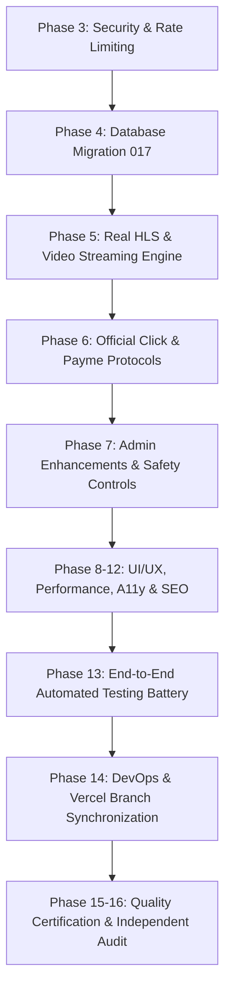

# AniCity — Master Engineering Implementation Plan

## 1. Roadmap & Phased Execution Matrix

---

## 2. Phase Breakdown & Deliverables

### Phase 3 & 4: Security Hardening & Distributed Rate Limiting
- **Deliverables:**
  - Create `supabase/migrations/017_distributed_rate_limiting.sql` with `public.rate_limits` table and atomic `check_rate_limit` RPC.
  - Refactor `lib/rate-limit.js` to asynchronously query the atomic database rate limiter with fail-safe fallback to local memory.
  - Patch `next.config.mjs` to restrict `images.remotePatterns` to trusted CDNs (Supabase, Google, Unsplash, AniList, MAL).
  - Verify auth actions (`login`, `register`, `forgotPassword`) under distributed multi-instance scenarios.

### Phase 5: Real HLS & Video Streaming Engine
- **Deliverables:**
  - Install `hls.js` dependency for universal cross-browser adaptive bitrate playback.
  - Extend `components/Player.js` (and player subcomponents) with:
    - Adaptive `.m3u8` playlist detection.
    - `Hls.isSupported()` engine initialization with buffer and network error recovery.
    - Native HLS fallback for Apple Safari (`video.canPlayType('application/vnd.apple.mpegurl')`).
    - Quality level selector UI (`1080p`, `720p`, `480p`, `360p`, `Auto`).
  - Create secure playback token validation endpoint `/api/video/token`.

### Phase 6: Official Click & Payme Merchant API Compliance
- **Deliverables:**
  - `lib/payments/click.js`:
    - Full implementation of `Prepare` (`action=0`) and `Complete` (`action=1`).
    - MD5 signature generation and verification adhering strictly to Click documentation.
    - Click standard response schema `{ click_trans_id, merchant_trans_id, merchant_prepare_id, error, error_note }`.
  - `lib/payments/payme.js`:
    - Strict **JSON-RPC 2.0** state machine (`CheckPerformTransaction`, `CreateTransaction`, `PerformTransaction`, `CancelTransaction`, `CheckTransaction`).
    - Standard Payme error codes (`-31001` to `-31050`).
  - Update `app/api/payments/webhook/route.js` to route cleanly between Click, Payme, and Sandbox.
  - Automated protocol simulation test suite with 100% assertion coverage.

### Phase 7: Admin Dashboard & Content Operations
- **Deliverables:**
  - Safe confirmation modal for destructive operations (unpublish, delete episode).
  - Server-side pagination controls for large user and anime catalogs.
  - Scoped assistant admin permission audit logging.

### Phase 8-12: UI/UX, Performance, Accessibility & SEO
- **Deliverables:**
  - Audit viewports: 360px, 375px, 390px, 430px, 768px, 1024px, 1440px, 1920px.
  - Zero CLS skeleton states during catalog and stream loading.
  - Enforce WCAG 2.2 AA accessibility standards.

### Phase 13-16: Automated Testing, Deployment & Final Audit
- **Deliverables:**
  - Automated test suite verifying Click, Payme, HLS, rate limiting, and database constraints.
  - Production build verification with Next.js Turbopack.
  - Align Vercel branch deployment (`feature/takeover-codex-integration` and `main`).
  - Author comprehensive 18-category Quality Audit in `docs/FINAL_AUDIT.md`.
