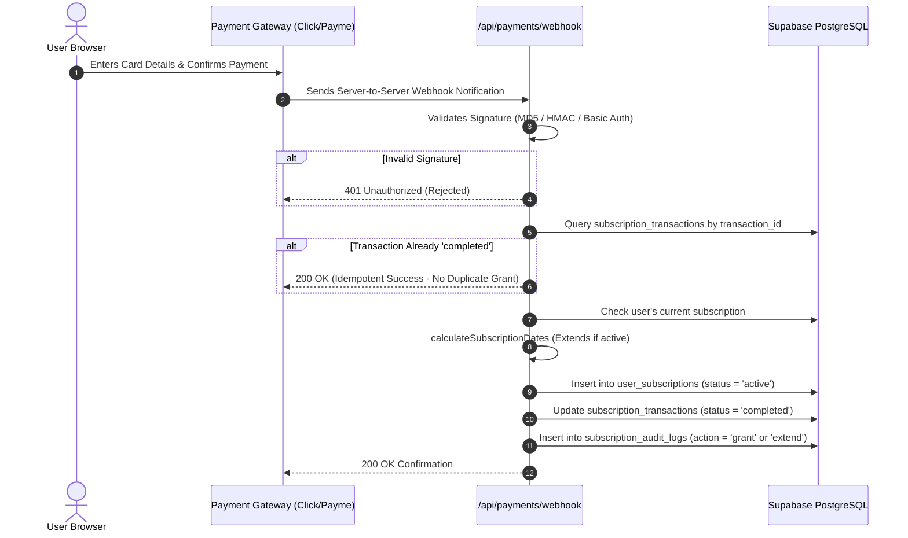

# AniCity — VIP Subscriptions & Payment Gateway Integration

## 1. Architecture Overview

AniCity features a modular, provider-agnostic payment processing architecture (`lib/payments/provider.js`) designed to support regional payment systems in Uzbekistan (**Click**, **Payme**) and international providers (**Stripe**), alongside a local **Sandbox** engine for safe development and staging verification.

---

## 2. Supported Payment Providers

| Gateway | Type | Currency | Integration Mode |
| :--- | :--- | :--- | :--- |
| **Click** | Merchant API | UZS | Redirect URL + MD5 Signature Webhook |
| **Payme** | Merchant API (Paycom) | UZS (in tiyin) | Base64 URL + Basic Auth Webhook |
| **Stripe** | Checkout API | USD / Multi | Session Redirect + HMAC Signature Webhook |
| **Sandbox** | Local Simulator | UZS | Instant testing without actual financial debit |

---

## 3. Webhook Lifecycle & Idempotency

All payment callbacks are processed through a single secure endpoint:
`POST /api/payments/webhook?provider={click|payme|sandbox}`



---

## 4. Idempotency Guarantees

Double-charging and duplicate grant prevention is enforced at the database level:
1. `subscription_transactions.transaction_id` has a `UNIQUE` constraint.
2. The webhook handler queries the transaction table before executing business logic. If the transaction has already reached `completed` status, the request returns immediately with `{ success: true, message: 'Tranzaksiya avval bajarilgan (idempotent)' }`.
3. Database mutations are committed atomically, preventing partial grants.

---

## 5. Subscription Extension Logic (`calculateSubscriptionDates`)

When a user purchases a subscription while their existing VIP tier is still active, AniCity ensures they never lose paid time:
- **Active Subscription:** The new duration (e.g. 30 days) is appended to `current.expires_at`.
- **Expired Subscription:** The new duration begins immediately from `now`.
- **Audit Logging:** Every grant or extension records `previous_plan`, `previous_expires_at`, `new_plan`, and `new_expires_at` into `subscription_audit_logs`.

---

## 6. Environment Configuration for Payments

```env
# Click Integration
CLICK_SERVICE_ID=your_click_service_id
CLICK_MERCHANT_ID=your_click_merchant_id
CLICK_SECRET_KEY=your_click_secret_key

# Payme Integration
PAYME_MERCHANT_ID=your_payme_merchant_id
PAYME_SECRET_KEY=your_payme_secret_key

# Stripe Integration (Optional)
STRIPE_SECRET_KEY=sk_live_...
STRIPE_WEBHOOK_SECRET=whsec_...

# Sandbox Testing Secret
PAYMENTS_SANDBOX_SECRET=anicity-sandbox-secret
```
