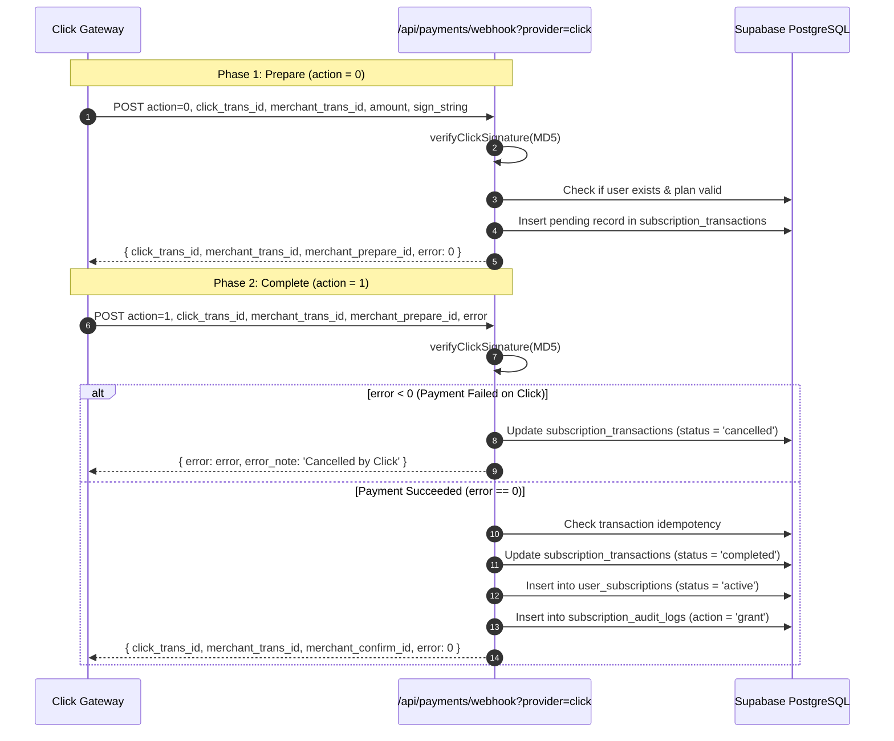
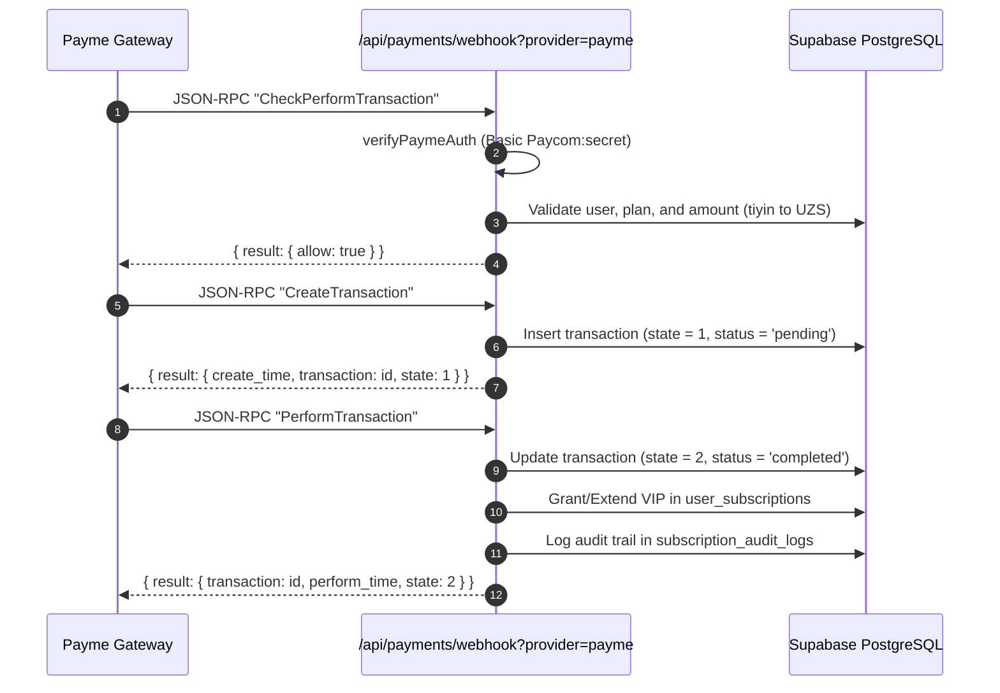

# AniCity — VIP Subscriptions & Payment Gateway Integration

## 1. Architecture Overview

AniCity features a modular, provider-agnostic payment processing architecture (`lib/payments/click.js`, `lib/payments/payme.js`, `lib/payments/provider.js`) designed to support regional payment systems in Uzbekistan (**Click**, **Payme**) and international providers (**Stripe**), alongside a local **Sandbox** engine for safe development and staging verification.

---

## 2. Supported Payment Providers

| Gateway | Type | Currency | Integration Mode | Verification Status |
| :--- | :--- | :--- | :--- | :--- |
| **Click** | Merchant API | UZS | Redirect URL + MD5 Signature Webhook | Partially Verified (Code/Mock Verified; Real Sandbox Pending) |
| **Payme** | Merchant API (Paycom) | UZS (in tiyin) | Base64 URL + Basic Auth Webhook (JSON-RPC 2.0) | Partially Verified (Code/Mock Verified; Real Sandbox Pending) |
| **Stripe** | Checkout API | USD / Multi | Session Redirect + HMAC Signature Webhook | Code Ready |
| **Sandbox** | Local Simulator | UZS | Instant testing without actual financial debit | Fully Verified (Active) |

---

## 3. Webhook Lifecycle & State Machines

All payment callbacks are processed through:
`POST /api/payments/webhook?provider={click|payme|sandbox}`

### 3.1 Click Merchant API State Machine (`lib/payments/click.js`)

Click requires a two-step handshake via HTTP POST form-encoded or JSON requests:



#### Official Click Error Codes Returned:
- `0` — Success
- `-1` — Signature verification failed (`SIGN CHECK FAILED`)
- `-2` — Incorrect amount (`INCORRECT AMOUNT`)
- `-5` — User or plan not found (`USER NOT FOUND`)
- `-6` — Transaction not found or invalid prepare ID (`TRANSACTION NOT FOUND`)
- `-7` — Internal database error (`FAILED TO UPDATE USER`)
- `-9` — Transaction already cancelled (`TRANSACTION CANCELLED`)

---

### 3.2 Payme Merchant API State Machine (`lib/payments/payme.js`)

Payme requires strict conformance with the **JSON-RPC 2.0** protocol, authenticated via HTTP Basic Auth:



#### Official Payme JSON-RPC Error Codes Returned:
- `-31001` — Order / user does not exist or invalid amount
- `-31008` — Operation cannot be performed in current state
- `-31050` — Merchant authentication failed (invalid credentials)
- `-31051` — Transaction not found

---

## 4. Idempotency Guarantees

Double-charging and duplicate grant prevention is enforced at the database level:
1. `subscription_transactions.transaction_id` has a `UNIQUE` constraint.
2. The webhook handler queries the transaction table before executing business logic. If the transaction has already reached `completed` status, the request returns immediately with success response.
3. Database mutations are committed atomically, preventing partial grants.

---

## 5. Subscription Extension Logic (`calculateSubscriptionDates`)

When a user purchases a subscription while their existing VIP tier is still active, AniCity ensures they never lose paid time:
- **Active Subscription:** The new duration (e.g. 30 days) is appended to `current.expires_at`.
- **Expired Subscription:** The new duration begins immediately from `now`.
- **Audit Logging:** Every grant or extension records `previous_plan`, `previous_expires_at`, `new_plan`, and `new_expires_at` into `subscription_audit_logs`.

---

## 6. How to Go from Sandbox to Production

1. **Obtain Official Merchant Credentials:**
   - For **Click**: Obtain `CLICK_SERVICE_ID`, `CLICK_MERCHANT_ID`, and `CLICK_SECRET_KEY` from Click Merchant Portal.
   - For **Payme**: Obtain `PAYME_MERCHANT_ID` and `PAYME_SECRET_KEY` from Payme Business Cabinet.
2. **Configure Environment Variables:**
   Add credentials to Vercel Project Settings > Environment Variables:
   ```env
   CLICK_SERVICE_ID=...
   CLICK_MERCHANT_ID=...
   CLICK_SECRET_KEY=...
   PAYME_MERCHANT_ID=...
   PAYME_SECRET_KEY=...
   ```
3. **Set Webhook URLs in Merchant Portals:**
   - Click Prepare URL: `https://anicity-app.vercel.app/api/payments/webhook?provider=click`
   - Click Complete URL: `https://anicity-app.vercel.app/api/payments/webhook?provider=click`
   - Payme Merchant Endpoint: `https://anicity-app.vercel.app/api/payments/webhook?provider=payme`
4. **Run Live Sandbox Handshake Verification:**
   Execute real test cards provided by Click/Payme support to verify signature matching before switching merchant status to active.
