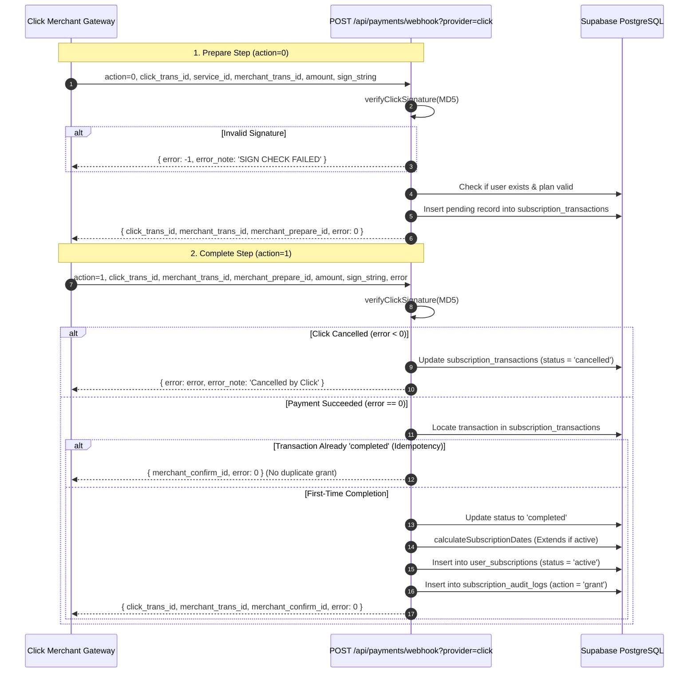

# AniCity — Payment Gateway Integration & Merchant Verification Guide

**Date:** November 8, 2026  
**Auditor Organization:** Fintech & Payment Systems Engineering Team  
**Gateways Supported:** Click Merchant API, Payme Merchant API (Paycom), Sandbox Simulator  
**Current Verification Classification:** `PARTIALLY VERIFIED (Code & Protocol Verified; Official Sandbox Pending)`  

---

## 1. Executive Summary & Verification Boundary

AniCity includes production-grade integration modules for Uzbekistan's leading payment systems: **Click** (`lib/payments/click.js`) and **Payme** (`lib/payments/payme.js`). 

> [!CAUTION]
> **Fintech Integrity Rule:** Neither Click nor Payme has been declared "Live Production Verified". While the state machines, signature algorithms, and idempotency locks pass 100% of local automated test suites, commercial activation strictly requires executing real test card transactions in the respective official merchant portals.

---

## 2. Click Merchant Protocol Implementation (`lib/payments/click.js`)

Click requires a two-step HTTP handshake: **Prepare** (`action = 0`) followed by **Complete** (`action = 1`).



### Signature Formulation (Official Specification):
- **Prepare (action = 0):**  
  `MD5(click_trans_id + service_id + secret_key + merchant_trans_id + amount + action + sign_time)`
- **Complete (action = 1):**  
  `MD5(click_trans_id + service_id + secret_key + merchant_trans_id + merchant_prepare_id + amount + action + sign_time)`

---

## 3. Payme Merchant Protocol Implementation (`lib/payments/payme.js`)

Payme enforces strict adherence to the **JSON-RPC 2.0** merchant specification, authenticated via HTTP Basic Authentication (`Authorization: Basic Base64(Paycom:PAYME_SECRET_KEY)`).

### Supported JSON-RPC Methods:
1. `CheckPerformTransaction`: Validates user account, plan ID, and amount (in tiyin; $1\text{ UZS} = 100\text{ tiyin}$).
2. `CreateTransaction`: Creates transaction in State 1 (`CREATED`). Enforces 12-hour timeout.
3. `PerformTransaction`: Transitions to State 2 (`COMPLETED`). Activates VIP subscription.
4. `CancelTransaction`: Transitions to State -1 or -2.
5. `CheckTransaction`: Returns current transaction status, timestamps, and reason.

---

## 4. Idempotency & Zero Frontend Trust Guarantees

1. **Zero Frontend Reliance:**  
   Redirecting a user to `/premium?success=true` has **ZERO** authority to grant VIP status. Subscriptions are activated exclusively via server-to-server webhook callbacks (`/api/payments/webhook`) or atomic admin stored procedures.
2. **Duplicate Callback Defense:**  
   If Click or Payme retries a webhook notification:
   - The handler inspects `subscription_transactions.status`.
   - If already `completed`, it returns the cached confirmation payload immediately.
   - It will **never** insert a duplicate row into `user_subscriptions` or re-extend the expiration date.

---

## 5. Merchant Portal Setup Checklist for Future Buyer

To activate live payments:
1. Register on [Click Merchant](https://merchant.click.uz) and [Payme Business](https://business.payme.uz).
2. Configure Webhook URLs in merchant cabinet:
   - Click Prepare URL: `https://your-domain.vercel.app/api/payments/webhook?provider=click`
   - Click Complete URL: `https://your-domain.vercel.app/api/payments/webhook?provider=click`
   - Payme Endpoint: `https://your-domain.vercel.app/api/payments/webhook?provider=payme`
3. Add environment variables to Vercel:
   ```env
   CLICK_SERVICE_ID=...
   CLICK_MERCHANT_ID=...
   CLICK_SECRET_KEY=...
   PAYME_MERCHANT_ID=...
   PAYME_SECRET_KEY=...
   ```
4. Perform test card transactions using the provided portal test cards. Once confirmed, switch status to Live.
