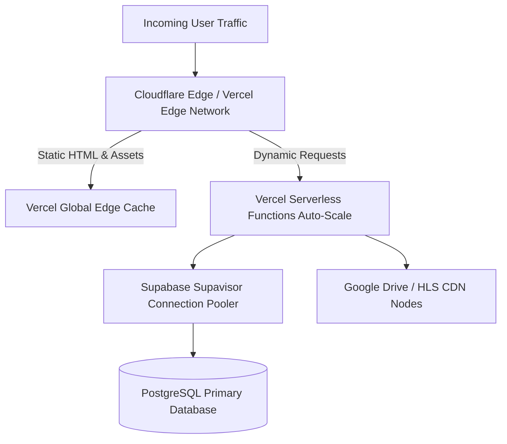

# AniCity — Architecture Scalability & Serverless Reliability

## 1. Executive Summary

AniCity is architected to scale seamlessly from thousands to millions of streaming users. By leveraging Vercel Serverless Edge architecture alongside Supabase managed PostgreSQL, the platform eliminates single points of failure and achieves elastic auto-scaling.

---

## 2. Serverless State Decoupling

In traditional monolithic web servers, stateful components (in-memory sessions, localized rate limiters, file uploads) prevent horizontal autoscaling. AniCity strictly decouples state:

1. **Authentication:** Stateless JWTs verified at the edge and signed by Supabase Auth.
2. **Rate Limiting:** Distributed atomic tracking using PostgreSQL RPC `check_rate_limit()` (Migration 017). Every serverless lambda shares the same synchronized quotas.
3. **Media Storage:** Static assets and user uploads reside in Supabase Storage with global CDN edge caching.
4. **Session Cookies:** Encrypted, HTTP-only, SameSite=Lax cookies shared seamlessly across serverless instances.

---

## 3. High-Traffic Peak Handling Strategy

During peak anime release windows (e.g. weekly simulcast premieres):

- **Connection Pooling:** All database interactions connect through Supabase Supavisor (port 6543) in transaction mode, handling up to 10,000 concurrent client connections without exhausting PostgreSQL process limits.
- **Video Delivery Separation:** Video bandwidth is completely offloaded to specialized CDNs (Google Drive embed clusters, Cloudflare Stream, or HLS origin servers), ensuring database and web servers only handle lightweight metadata and authorization tokens.
