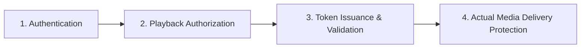

# AniCity — Modular Video Delivery Architecture & Provider Specification

**Date:** November 8, 2026  
**Auditor Organization:** Video Streaming & Distributed Systems Engineering Team  
**Architecture Status:** Modular Multi-Provider Abstraction Active  

---

## 1. Architectural Principles & Layer Separation

To ensure commercial longevity and eliminate vendor lock-in, AniCity isolates video playback into four distinct architectural layers:

1. **Authentication:** Confirms who the user is via Supabase Auth stateless JWTs.
2. **Playback Authorization:** Evaluates server-side whether the user is permitted to watch the target episode (checks published status, account suspension, and active VIP subscription).
3. **Token Issuance & Validation:** Issues short-lived, cryptographically signed HMAC-SHA256 playback tokens bound to `userId` and `episodeId`.
4. **Actual Media Delivery Protection:** The edge infrastructure that enforces token validation before delivering video bytes/segments to the client.

> [!WARNING]
> **Commercial Truth:** Layers 1–3 are completely controlled by AniCity's Next.js application. Layer 4 depends on the streaming provider infrastructure. Without an edge proxy or signed CDN, media bytes from third-party hosts (Google Drive, static MP4s) stream outside the cryptographic token boundary.

---

## 2. Multi-Provider Abstraction Layer (`lib/video/provider.js`)

AniCity abstracts streaming sources so that anime catalog entries can utilize different providers without requiring alterations to the web player or application code.

### Supported Provider Adapters:

| Provider Key | Detection Pattern | Delivery Mechanism | Edge Security Enforceability | Status in AniCity |
| :--- | :--- | :--- | :---: | :---: |
| **`drive`** | `drive:*`, `drive.google.com` | Protected `/preview` Iframe | Low (Iframe Sandbox Only) | **Production Active** |
| **`hls`** | `.m3u8` | Native HLS / `hls.js` Adaptive Engine | High (With CDN Signed Cookies) | **Production Active** |
| **`direct`** | `.mp4`, `.webm`, `.mkv` | HTML5 `<video>` Player | Medium (Requires Edge Media Proxy) | **Production Active** |
| **`cloudflare`** | `videodelivery.net`, `cloudflarestream.com` | Cloudflare Stream Signed Player | Highest (Edge Token Verification) | **Adapter Ready** |
| **`bunny`** | `b-cdn.net`, `bunnycdn.com` | Bunny.net Stream HLS | Highest (Token-Protected Manifests & Segments) | **Adapter Ready** |
| **`mux`** | `stream.mux.com` | Mux Video Signed Playback | Highest (JWT Signed Playback IDs) | **Adapter Ready** |

---

## 3. Server-Side VIP Authorization & Token Lifecycle

### 3.1 Token Duration Constraint
A playback token **must never outlive the subscription authorization period**:
- Default TTL: 7,200 seconds (2 hours).
- If the user's active VIP subscription expires in less than 2 hours (e.g. in 45 minutes), the token TTL is automatically clamped to the exact remaining subscription seconds:
  $$\text{effectiveTTL} = \min(7200, \text{subscriptionRemainingSeconds})$$
- When a subscription is revoked or expires, subsequent token requests for VIP episodes are immediately rejected with `403 Forbidden` (`VIP_REQUIRED`).

### 3.2 Dynamic Player Engine (`components/Player.js`)
The player seamlessly handles all abstracted providers:
- **HLS Streams:** Automatically mounts `hls.js`, parses multi-bitrate levels (`1080p`, `720p`, `480p`, `360p`), exposes a quality selector menu, and provides automatic buffer/network recovery.
- **Safari / iOS:** Falls back to native HLS playback via `canPlayType('application/vnd.apple.mpegurl')`.
- **Google Drive:** Automatically wraps the embed in a container with `referrerPolicy="no-referrer"`, click-hijack popout guard, and an interactive reload overlay.

---

## 4. Provider Migration Roadmap for Future Buyer

AniCity requires **zero code rewrites** to transition from Google Drive to a commercial video CDN.

### Step-by-Step Migration Guide:
1. **Option A: Bunny.net Stream (Cost-Effective / Best for Central Asia):**
   - Create a Video Library on Bunny.net ($0.01/GB storage, $0.005/GB bandwidth).
   - Upload anime video files; Bunny automatically encodes them into HLS (`.m3u8`).
   - Store the resulting `playlist.m3u8` URL in `public.episodes.video_url`.
   - AniCity’s `detectProvider()` immediately recognizes the `.m3u8` extension and streams via `hls.js`.
2. **Option B: Cloudflare Stream (Turnkey Enterprise):**
   - Upload video to Cloudflare Stream.
   - Store the resulting Cloudflare Stream video URL or embed ID.
   - AniCity automatically routes to the Cloudflare streaming container.
