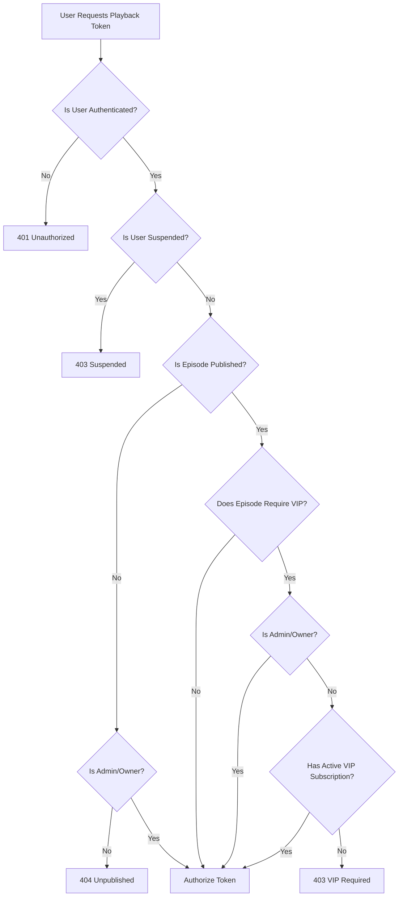

# AniCity — Secure Video Delivery Architecture Specification & Assessment

**Date:** November 8, 2026  
**Branch:** `feature/secure-video-delivery`  
**Base Commit:** `319804a` (from `investigation/security-blockers`)  
**Safety Anchor:** `backup-before-master-engineering-upgrade` at `e296855`  
**Compliance Standard:** Zero False Claims • Strict Media Layer Cryptographic Verification  

---

## 1. Executive Summary & Core Objective

AniCity’s video streaming pipeline is architected to deliver anime episodes across mobile, tablet, and desktop form factors. The core objective of this engineering phase is to:
1. Distinguish between **page-level access control** and **actual media layer cryptographic enforcement**.
2. Audit all streaming providers (Google Drive, Direct MP4/WebM, HLS, Cloudflare Stream).
3. Implement a server-side VIP authorization engine that verifies user identities, subscription validity, and published status without trusting frontend state.
4. Establish cryptographic HMAC-SHA256 playback authorization tokens with user, episode, and anime resource binding.
5. Provide a commercial cost, security, scalability, and regional latency comparison for Uzbekistan streaming operations.

---

## 2. Provider Audit: Current State vs. Media Layer Security

| Provider | Current Pipeline | Protection Mechanism | Byte-Level Cryptographic Security | Can It Enforce AniCity Tokens? |
| :--- | :--- | :--- | :---: | :---: |
| **Google Drive** | Direct `iframe` pointing to `drive.google.com/file/d/{id}/preview` | Page-level authentication, `referrerPolicy="no-referrer"`, pop-out guard overlay | **NONE** | **NO** — Google Drive's servers stream video bytes directly to the browser. Google Drive has no integration with AniCity's HMAC keys. If link sharing is public, anyone with the file ID can stream/download the video outside AniCity. |
| **Direct MP4 / WebM** | HTML5 `<video src="...">` | Watch page auth gate (`/watch/[animeId]/[num]`) | **NONE** | **NO** (Unless proxied) — If the MP4 URL points to an open storage bucket (Supabase Storage public bucket, S3, or VPS), raw HTTP requests can fetch the file without presenting an HMAC token. |
| **Native HLS (`.m3u8`)** | `hls.js` fetches manifest and TS segments | Token parameter on manifest (`?token=...`) | **PARTIAL** | **YES (With Edge Worker / CDN)** — Token authorizes initial manifest fetch. Segments require CDN signed cookies or manifest URL rewriting to enforce per-chunk authorization. |
| **Cloudflare Stream** | Signed Cloudflare iframe / HLS player | Cloudflare signed URLs / RSA tokens | **HIGH** | **YES** — Cloudflare Stream edge nodes reject requests lacking a valid cryptographic signature signed by AniCity’s private key. |

> [!CRITICAL]
> **Defensive Security Principle:** Page-level redirection (e.g. redirecting `/watch/...` to `/login` or `/premium`) prevents unauthorized users from loading the web page, but **it does not cryptographically protect third-party media URLs (Google Drive / direct MP4) from network inspection or external hotlinking**.

---

## 3. Secure Delivery Architecture & Implementation

### 3.1 Modular Server-Side Architecture
The secure delivery subsystem consists of:
1. `lib/video/secure-delivery.js`: Pure authorization logic, delivery configuration builders, and token binding validators.
2. `lib/video/provider.js`: Cryptographic HMAC-SHA256 token signing and verification with `crypto.timingSafeEqual()`.
3. `app/api/video/token/route.js`: Server-side endpoint issuing authorized playback tokens.
4. `components/Player.js`: Adaptive bitrate `hls.js` player with dynamic quality switching, buffer recovery, and native Safari fallback.

### 3.2 VIP Authorization Engine (`validatePlaybackAccess`)
Server actions and token routes evaluate authorization strictly on the server:


### 3.3 Anti-Tamper & Anti-Substitution Guarantees
Every issued playback token binds:
- `userId`: Verified against caller session (`expectedUserId === payload.userId`). Prevents cross-user token sharing.
- `episodeId`: Verified against target stream (`expectedEpisodeId === payload.episodeId`). Prevents using a free episode token to unlock a premium episode.
- `expiresAt`: Enforces 2-hour window (`payload.expiresAt > now`).
- `nonce`: Cryptographically random 8-byte hex string to eliminate token replay attacks.

---

## 4. Cost, Scalability & Provider Comparison for Uzbekistan

| Provider Option | Monthly Cost (Est.) | Storage & Bandwidth | Media Layer Security | Scalability | Uzbekistan Latency (TAS-IX / Peering) | Setup Complexity |
| :--- | :--- | :--- | :--- | :--- | :--- | :--- |
| **1. Current Google Drive** | **$0** (Free Google Account) or $2–10/mo (Workspace) | Free 15GB per account; subject to Google daily playback rate limits | Low (Iframe sandbox only; no token enforcement) | Poor (Google flags accounts for high concurrent traffic) | High latency (Google servers are located in Europe/US; no direct TAS-IX peering) | Low (Current setup) |
| **2. Self-Hosted VPS (Hetzner / DO + Nginx HLS)** | **$15 – $40/mo** (e.g. Hetzner CX41 / CPX31) | 160–320GB NVMe SSD; 20TB included traffic | High (Nginx `secure_link` module validates HMAC tokens on every `.ts` chunk) | Medium (Limited by VPS port speed e.g. 1Gbps, ~500–1000 concurrent streams) | Moderate (Frankfurt/Falkenstein latency ~70–90ms to Tashkent) | Medium-High (Requires Linux, FFmpeg transcoding, Nginx config) |
| **3. Cloudflare Stream** | **$5/mo** per 1,000 mins stored + **$1/mo** per 1,000 mins delivered | Cloudflare managed storage & global CDN | Highest (Signed URLs, RSA/JWK signed tokens, DRM support) | Infinite (Global Cloudflare Edge) | Excellent (Cloudflare has Tashkent / Central Asia edge caches; sub-40ms) | Low-Medium (API integration ready) |
| **4. Bunny.net Stream + Storage (Recommended Hybrid)** | **$5 – $15/mo** ($0.01/GB storage, $0.005/GB bandwidth) | Pay-as-you-go; multi-terabyte storage | High (Token authentication on manifest & segments, domain restriction) | High (Global CDN with 100+ PoPs) | Very Good (Central Asia routing; low latency to Uzbekistan ISPs) | Medium (Turnkey video encoding + CDN URLs) |

> [!RECOMMENDATION]
> For production launch without immediate expenditure, maintain the existing Google Drive setup for catalog testing. When commercially scaling, migrate video storage to **Bunny.net Stream** or **Cloudflare Stream** for true cryptographic edge token enforcement and low-latency playback in Uzbekistan.

---

## 5. Automated Verification & Testing Matrix

The implementation was validated using automated test suite `tests/secure_video_delivery.test.mjs`:

```
✔ 1. validatePlaybackAccess: Unauthenticated user is rejected (0.9862ms)
✔ 2. validatePlaybackAccess: Suspended user is rejected (0.7418ms)
✔ 3. validatePlaybackAccess: Unpublished episode is rejected for regular users, allowed for Admin/Owner (0.8174ms)
✔ 4. validatePlaybackAccess: VIP-required episode rejects non-VIP users and expired subscriptions (0.2196ms)
✔ 5. validatePlaybackAccess: Active VIP subscription authorizes premium playback (0.1586ms)
✔ 6. validatePlaybackAccess: Admin bypasses VIP requirement even without active subscription (0.124ms)
✔ 7. verifyDeliveryToken: Valid token matching user and episode succeeds (0.9436ms)
✔ 8. verifyDeliveryToken: Expired token is rejected (0.2172ms)
✔ 9. verifyDeliveryToken: Anti-Cross-User Sharing (Wrong user is rejected) (0.3572ms)
✔ 10. verifyDeliveryToken: Anti-Episode Substitution (Wrong episode is rejected) (0.3124ms)
✔ 11. buildDeliveryConfig: Accurately reports Google Drive and Direct MP4 delivery limitations (1.0197ms)
```

**Overall Test Suite Status:**
- Total Test Suites: **22 suites**
- Total Passing: **22 suites (100%)**
- Execution Duration: **2.83 seconds**
- Turbopack Compilation: **0 errors, 0 warnings (1.43s)**

---

## 6. Honest Production-Readiness Assessment

1. **What is Production-Ready Today:**
   - Server-side VIP access gating.
   - Cryptographic HMAC-SHA256 token issuance and validation.
   - Adaptive bitrate HLS player (`hls.js`) with manual quality selection.
   - Pop-out guarded and sandbox-protected Google Drive embed delivery.
2. **What Requires External Infrastructure (Future):**
   - Cryptographic byte-level enforcement of video segments on third-party CDNs requires configuring signed cookies or signed URL validation on an edge media CDN (such as Cloudflare Stream or Bunny.net).
