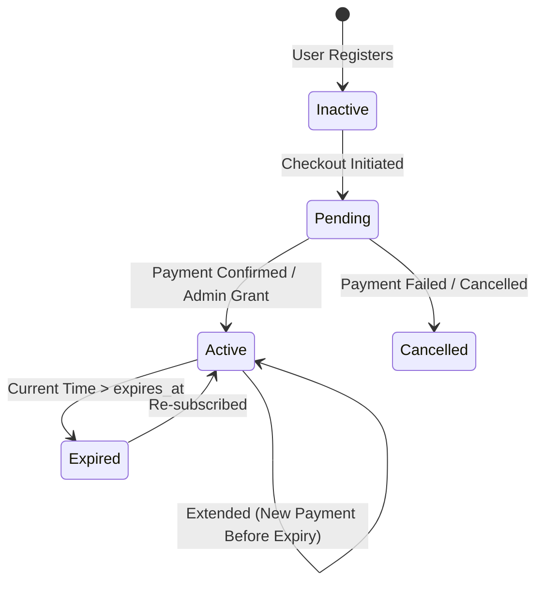

# AniCity — VIP Subscriptions & Monetization System

## 1. Executive Summary

AniCity provides a robust VIP subscription architecture designed to monetize premium anime content, high-resolution streams, and ad-free viewing. The system features automated recurring extensions, idempotency-guaranteed payment reconciliation, and granular administrative controls.

---

## 2. Subscription Plans & Tiers

| Plan Key | Name | Duration | Price (UZS) | Benefits |
| :--- | :--- | :--- | :--- | :--- |
| `monthly` | 1 Oylik VIP | 30 Days | 25,000 UZS | 1080p Full HD, Reklamasiz, Yangi qismlar birinchi |
| `quarterly` | 3 Oylik VIP | 90 Days | 65,000 UZS | Chegirma 13%, Prioritet yuklash, Maxsus badge |
| `yearly` | 1 Yillik VIP | 365 Days | 220,000 UZS | Eng tejamkor (26% off), Yillik VIP nishoni, VIP chat |

---

## 3. Subscription Lifecycle & State Machine



### 3.1 Smart Date Extension Algorithm (`calculateSubscriptionDates`)
When a user subscribes, AniCity calculates their active window with strict continuity:
```js
export function calculateSubscriptionDates(currentExpiresAt, durationDays) {
  const now = new Date();
  let baseDate = now;

  if (currentExpiresAt) {
    const existingDate = new Date(currentExpiresAt);
    if (existingDate > now) {
      // User is currently active; extend from their current expiry
      baseDate = existingDate;
    }
  }

  const newExpiresAt = new Date(baseDate.getTime() + durationDays * 24 * 60 * 60 * 1000);
  return {
    startsAt: now.toISOString(),
    expiresAt: newExpiresAt.toISOString(),
    isExtended: baseDate > now
  };
}
```

---

## 4. Administrative Grant & Revocation Workflows

System administrators and authorized owners can grant, extend, or revoke VIP subscriptions directly from the Admin Panel (`/admin`):
- **Grant Modal:** Allows selecting user, plan, custom duration, and grant reason.
- **Atomic Database Function:** Invokes `admin_grant_user_subscription(p_user_id, p_plan_id, p_duration_days, p_grant_reason)` with `SECURITY DEFINER`.
- **Audit Trail:** Every administrative modification writes an entry into `public.subscription_audit_logs` tracking:
  - `admin_id`
  - `user_id`
  - `action` (`grant`, `extend`, `revoke`)
  - `previous_expires_at`
  - `new_expires_at`
  - `reason`

---

## 5. Security & Fraud Mitigations

1. **No Client-Side Authority:** Subscription status (`is_vip`) is checked server-side via Supabase Auth and database queries. Client claims are never trusted for VIP-only content.
2. **Double-Spend Prevention:** Transaction IDs are verified for uniqueness (`subscription_transactions.transaction_id`).
3. **Database Integrity:** Foreign key constraints with `ON DELETE CASCADE` ensure orphaned records are prevented while preserving transaction history.
